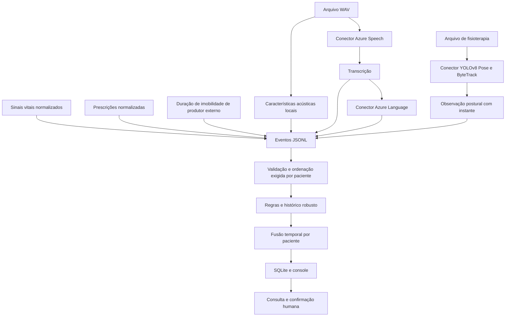

# Arquitetura e fluxo multimodal

O desenho descreve o fluxo implementado. Os caminhos Azure e YOLO têm conectores e testes simulados; sua validação real permanece pendente. O TXT de demonstração local é fornecido explicitamente, sem passar pelo Speech.

| Arquivo | Responsabilidade |
|---|---|
| `sentinela/core.py` | Validação, histórico de sinais, prescrições, fusão e Store SQLite |
| `sentinela/media.py` | Extração WAV e conectores Azure/YOLO |
| `sentinela/cli.py` | Comandos, ingestão, exportação e avaliação sintética |
| `sentinela/demo.py` | Geração determinística dos dados de teste |
| `config.json` | Parâmetros locais |
| `sentinela/default_config.json` | Mesmos parâmetros, incluídos na instalação |

## Estado e persistência

O monitor processa eventos em ordem por paciente e descarta IDs já vistos. Cada novo evento e seus alertas são gravados em uma transação SQLite. Após reinício, o histórico de eventos recompõe baseline e janela de fusão. IDs precisam ser únicos e imutáveis. A versão das regras não fica gravada no banco; use saída nova quando mudar configuração.

O motor mantém até 30 medidas normais por sinal, mas a lista de IDs vistos cresce com o histórico. O replay de todos os eventos e a leitura do arquivo inteiro de áudio não foram dimensionados para grande escala. O projeto pressupõe um consumidor por banco.

## Fronteiras

Áudio e vídeo operam em lote. `run --follow` acompanha linhas acrescentadas ao arquivo a cada 250 ms, sem rotação ou truncamento. Isso não mede latência fim a fim nem oferece captura contínua de mídia. Não existem API HTTP, painel web, integração com prontuário, sensor físico ou canal externo de notificação.
